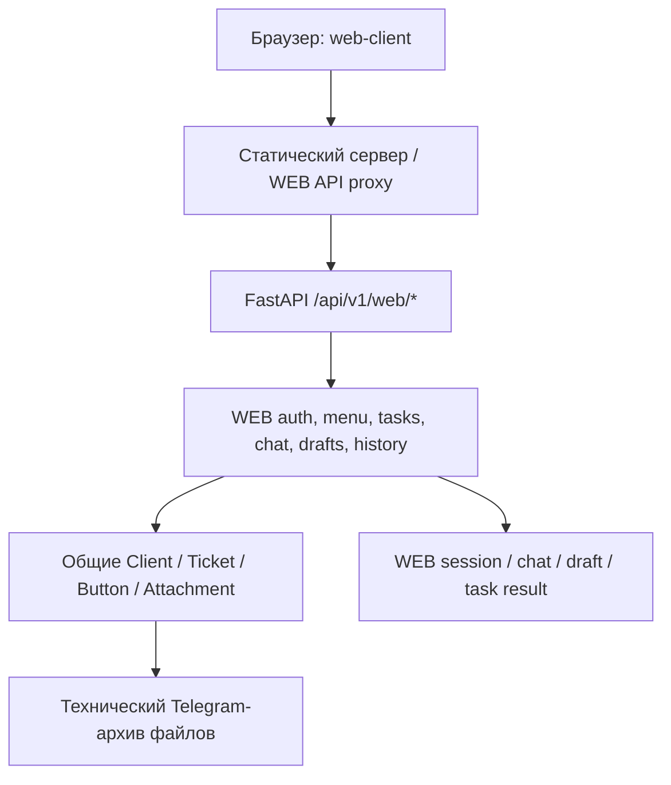
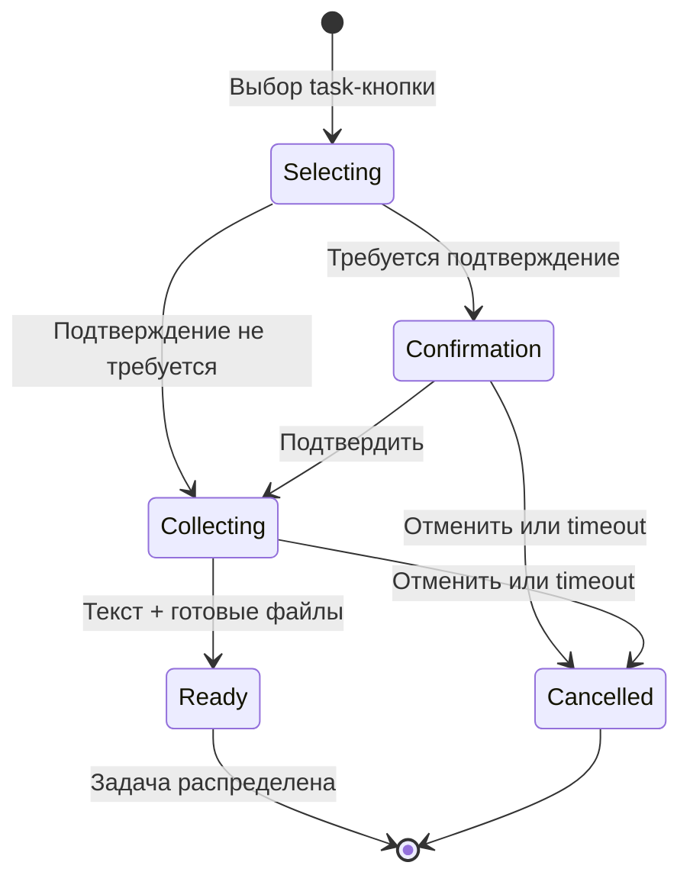

# ES DESK — клиентский WEB-канал: текущая реализация

> **Статус:** исследовательская документация по исходникам; контрольная точка **v0.12**, 2026-11-08.  
> **Ревизия проверенного Windows-репозитория:** `8439b32`; `git status` в обеих выгрузках: только `?? docs/current/`.  
> **Исходники:** две крупные выгрузки шага 39 (`Вставленный текст(20261108-175323).txt` — серверные WEB-модули; `Вставленный текст(20261108-184310).txt` — весь `web-client/` и индекс общих вызовов), а также ранее полностью прочитанный `api/app/services/web_tasks.py` на шаге 38.  
> **Границы доказательства:** исходный код прочитан без запуска браузера, тестов, DEV-smoke, миграций и API-запросов. Фактическая конфигурация и работа PROD не проверялись. Старая проектная документация не использована как источник истины.

## 1. Назначение и принципиальное состояние

WEB — отдельный браузерный клиент поддержки «Элитного Сочи», работающий с теми же сущностями `Client`, `Ticket`, `BotButtonSetting` и вложений, что и основной backend. Он не является второй системой заявок и не напрямую обращается к Telegram-боту из браузера.

**Что реализовано и доступно из текущего клиентского интерфейса:**

1. Вход по WEB-логину/паролю, проверка сессии, выход.
2. Чтение клиентского меню из действующей конфигурации кнопок.
3. Создание **обычной задачи** (`workflow_type=task`, `task_kind=normal`) через выбор пункта, условное подтверждение, одно текстовое описание и прикреплённые файлы.
4. Технический WEB-чат с системными событиями выбора/создания и уведомлениями о превышении размера файла.
5. Серверный черновик текста и долговременные предварительные загрузки файлов.
6. История собственных WEB- и Telegram-обращений, открытие допустимой части переписки, скачивание разрешённых файлов и просмотр опубликованных результатов WEB-задач.
7. Ручная отмена **незавершённого создания** WEB-задачи и автоматическое истечение срока описания.

**Что не следует считать работающим:** создание обычной WEB-заявки (`workflow_type=ticket`) из клиентского интерфейса сейчас явно отключено; обычные кнопки, кроме терминальных `task`, не выполняют серверное действие. Групповые задачи и кнопочные автоматизации нельзя запускать через имеющийся WEB task-intake. Окончательный ответ WEB-задачи показывается в истории после закрытия сотрудником, а не отправляется клиенту в технический чат как полноценный диалог. Кнопка «Закрыть обращение» в текущем интерфейсе отменяет лишь стадию создания задачи; она не даёт клиенту закрыть уже созданную/распределённую заявку.

## 2. Архитектурные границы и маршрут запроса

- `web-client/dev-server.mjs` отдаёт allowlist статических файлов и проксирует только предусмотренные WEB API-пути на FastAPI. Он **не** проверяет пароль и не хранит прикладную авторизацию. Вне Docker upstream ограничен HTTP loopback `127.0.0.1`; в Docker разрешён `http://api:8000`. Публичный origin задан `WEB_CLIENT_ORIGIN` и должен совпадать с `Host`/`Origin` браузера.
- Прокси пропускает только cookie `esdesk_web_session`, не пересылает другие, в том числе служебные/сотруднические cookies. Пробрасываются `Content-Type`, `Content-Length`, `Origin`, `Sec-Fetch-Site`, а из ответов — необходимые типы и `Retry-After`. Роутинг ограничен методом и шаблоном пути, в частности UUID для файлов и результатов.
- У статического сервера выставлены `Cache-Control: no-store`, `X-Content-Type-Options: nosniff`, `Referrer-Policy: no-referrer` и CSP. Используются локальные JS/CSS, шрифты и иконки; в CSP предусмотрены отдельные CDN для библиотек, но их фактическая загрузка/применение в этом исследовании не проверялись.
- `web-client/api.js` использует только `/api/v1/web/*` с `credentials: same-origin`, `cache: no-store`, `redirect: error`. Обычный API timeout — **15 секунд**, для multipart upload — **360 секунд**. Это клиентские/прокси-ограничения, а не гарантированный срок завершения серверной операции.
- FastAPI WEB-роутеры используют `get_current_web_client` и отдельный `WebAuthRoute`, скрывающий потенциально чувствительные validation details в auth-запросах. Сотруднические `/api/v1/tickets/*` не являются клиентским WEB API.

## 3. Ответственность файлов

| Файл / группа | Подтверждённое назначение |
|---|---|
| `web-client/index.html`, `styles.css`, `workspace.css` | Стартовая оболочка, формы, адаптивный двухколоночный интерфейс, modal истории и мобильный split-view |
| `web-client/app.js` | Проверка `/auth/me`, вход/выход, экран авторизации, обработка лимита входов и потери сессии |
| `web-client/api.js` | Единственная браузерная обёртка WEB API, отмены запросов, проверка формата ответов, загрузки бинарных файлов |
| `web-client/workspace.js` | Меню, активная задача, описание, технический чат, polling, история, действия клиента, модальные окна |
| `web-client/composer-draft.js` | Двухуровневый черновик текста: серверная версия + локальный fallback; согласование конфликтов |
| `web-client/task-files.js` | Список файлов черновика, предзагрузка, восстановление, статусы, retry/delete/preview, резервирование при отправке |
| `web-client/file-size-notices.js` | Уведомление серверу о попытке выбрать файл свыше лимита без передачи содержимого |
| `web-client/history-media.js` | Безопасное браузерное получение, локальное preview/zoom вложений истории |
| `web-client/appearance.js` | Светлая/тёмная тема и визуальные настройки только до перезагрузки страницы |
| `web-client/dev-server.mjs` | Белый список статических путей и same-origin WEB API-прокси |
| `routers/web_auth.py`, `services/web_auth.py` | Логин, сессии, CSRF, проверка владельца, TTL и rate limit |
| `services/web_credentials.py`, `web_credentials_migration.py` | WEB-реквизиты в карточке клиента, генерация/хеширование/шифрование, перенос старых полей |
| `routers/web_menu.py`, `services/web_menu.py` | Проекция существующего Telegram-меню для авторизованного клиента |
| `routers/web_tasks.py`, `services/web_tasks.py` | State machine выбора/подтверждения/описания/отмены WEB-задачи и фоновое истечение |
| `routers/web_composer_draft.py`, `services/web_composer_draft.py` | Версионированный серверный черновик текста |
| `services/web_composer_draft_attachments.py`, `web_task_attachments.py` | Долговременные загрузки черновика, привязка к задаче, лимиты, архивирование |
| `routers/web_chat.py`, `services/web_chat.py`, `web_file_notifications.py` | Технические сообщения и уведомления о слишком больших файлах |
| `routers/web_history.py`, `services/web_history.py`, `web_history_messages.py` | Список обращений, фильтрация доступной переписки, скачивание вложений |
| `routers/web_task_results.py`, `services/web_task_results.py` | Публикация, чтение и скачивание **снимка** итогового ответа WEB-задачи |
| Общие `ticket_lifecycle.py`, `ticket_messages.py`, `ticket_attachments.py`, `telegram_outbound_delivery.py` | Статусы/закрытие сотрудником, вложения и технический Telegram-архив; WEB использует их, но это не отдельный Telegram-клиент |

## 4. Идентификация клиента и WEB-реквизиты

Для входа нужны заполненные WEB-реквизиты в `ClientProfile` **и** подтверждённый профиль (`is_verified`) с существующей `TelegramContact` той же компании/клиента, у которой непустой `external_user_id`. Следовательно, просто импортированная подтверждённая карточка без Telegram-идентичности ещё не становится доступным WEB-пользователем.

Хранение:

- `web_login` — отображаемый логин; `web_login_normalized` — нормализованный `strip().casefold()`, уникальный индекс по профилям; пробелы внутри не допускаются, предел **255** символов.
- `web_password_hash` — хеш для проверки на входе; `web_password_encrypted` — отдельное зашифрованное значение для контролируемого раскрытия в административной карточке. Пароль из legacy `custom_fields` не используется напрямую при входе.
- `web_credentials_version` — версия реквизитов, попадает в сессию. Замена/удаление пароля повышает её; старая сессия после смены версии отклоняется. Изменение одного только логина в рассмотренном `apply_changes` не повышает версию — этот момент нельзя расширять до утверждения об отзыве всех сессий при каждой правке логина.
- Настройка реквизитов использует существующие поля интерфейса `custom_web_login`, `custom_web_password`, но защищённые данные вынесены в колонки профиля. Из ответов карточки обычный пароль не должен попадать без специального контролируемого раскрытия; `is_readonly_chiki_piki` запрещён доступ к раскрытию.
- Генерация логина сначала предпочитает доступный Bitrix login, затем варианты имени/фамилии латиницей с доменом `@elitesochi.com` и суффиксом для уникальности. Пароль генерируется случайно, длина — **12** символов, с классами букв, цифр и спецсимволов. При существующих логине и пароле повторная генерация требует явного `regenerate`.
- `web_credentials_migration.py` переводит наследуемые данные из `custom_fields` в новые поля и завершает перенос по принципу fail-closed при неоднозначном конфликте/дубликате. Фактическое выполнение этой миграции в PROD отдельно не подтверждено.

## 5. WEB-сессия и защитные проверки

**Вход** — `POST /api/v1/web/auth/login`. Нормализованный логин + IP образуют ключ записи `WebLoginLimit`; после четвёртого неверного ввода начинает действовать экспоненциальная задержка от 30 секунд. Блокировка даёт HTTP **429** и `Retry-After`. Для неизвестных или не имеющих права входа учётных записей тоже выполняется проверка против dummy hash, чтобы не отделять их простым путём. При успехе создаётся случайный токен, в `WebClientSession` хранится **SHA-256 токена**, а браузеру выдаётся cookie с `HttpOnly`, `SameSite=Strict`, `Path=/api/v1/web`; флаг `Secure` включён в PROD/при соответствующей настройке.

**Защита CSRF:** для изменяющих запросов, включая login, требуется `Origin`, точно совпадающий с ожидаемым origin по `web_public_base_url`, `app_public_base_url` либо request base URL. `Sec-Fetch-Site: cross-site` отклоняется. Не полагаться на `X-Forwarded-*` как на источники доверенного origin: сервис явно не парсит их в этой проверке.

**Срок действия — два режима:**

| Условие | Проверяемое сервером истечение |
|---|---|
| Нет активной обычной WEB-заявки типа `ticket` | Следующие **20:00 по Москве** после входа (`normal_expires_at`) |
| Есть открытая WEB-заявка `workflow_type=ticket`, `task_kind=normal`, статус `unassigned`, `new` или `pending` | **24 часа после `last_activity_at`** |

Это динамическая проверка при каждом запросе, а не два независимых действующих токена. **Открытая WEB-задача `workflow_type=task` сама по себе 24-часовой режим не активирует.** В текущем WEB UI создание обычных `ticket` отключено, хотя условие их существования в авторизации предусмотрено. `GET`/периодический опрос не продлевают `last_activity_at`; `register_web_activity()` вызывается после конкретных успешных клиентских бизнес-действий в одной транзакции. Как только условие открытой обычной WEB-заявки перестаёт выполняться, применяется обычный `normal_expires_at`.

`GET /auth/me` подтверждает сессию; `POST /auth/logout` удаляет строку сессии и cookie. Проверка также отклоняет удалённый/неподходящий профиль и несовпадение версии реквизитов. При HTTP 401 браузер останавливает/отменяет WEB-запросы, блокирует композер и показывает диалог повторного входа. Это поведение UI, не гарантия отмены уже принятой сервером операции.

## 6. WEB-меню: общая база с Telegram

`GET /api/v1/web/menu` вызывает `read_client_menu()` и строит read-only представление `BotButtonSetting` из той же конфигурации Telegram:

1. Для подтверждённого профиля определяется назначение через `temporary_rop_destination`, привязку `BotMenuDestinationBinding` и список доступных menu names; иначе — `BASIC_MENU_NAME`.
2. Выбираются кнопки текущего меню, только `currently_present=True`, не `is_archived` и без отключающего переопределения видимости (`visibility_overridden && !is_enabled`).
3. Разделы/групповые родители раскрываются рекурсивно по `parent_path` / `button_path`; пустые подменю исключаются, циклы защищены множеством предков. Для `group_task` сохранённая секция считается Telegram-действием, а не вложенным меню.
4. Порядок/строки — через `BotMenuLevelLayout` и общие функции подготовки Telegram layout, стиль — через общую `_button_style_value()`.

**Критически:** отображение кнопки не означает, что WEB умеет выполнить её workflow. `workspace.js` вызывает `beginTask()` только для конечной кнопки `workflow_type === 'task'`; для другого workflow показывает «действие пока недоступно». Сервер дополнительно проверяет терминальность, видимость в клиентском меню, именно `task` и отсутствие `automation_key`. `group_task`, `ticket`, прочие автоматизации и их Telegram callback-процедуры не запускаются этим маршрутом.

## 7. Сквозное создание обычной WEB-задачи

`Selecting` — клиентский UI-этап, не отдельное значение `Ticket.intake_state`. Пока идёт серверное создание, фактически появляется `Ticket` со статусом `unassigned` и `intake_state=collecting`; если требуется подтверждение, API отображает состояние `confirmation_required`, но `intake_state` остаётся `collecting`.

### 7.1. Выбор `POST /tasks/select`

- Клиент генерирует `request_id` (UUID), повторяет **тот же** ID при сомнительном исходе запроса. Сервер вычисляет стабильный `task_id = UUID5(namespace, company_id:client_id:request_id)`.
- Перед действием `task_context` блокирует клиента в БД (`pg_advisory_xact_lock` для PostgreSQL, `BEGIN IMMEDIATE` для SQLite) и **после блокировки заново проверяет WEB-сессию**. Блокировка держится до commit/rollback; это защищает intake между воркерами на уровне одной БД.
- Проверяются доступность кнопки и отсутствие активной заявки клиента через общий механизм Telegram. Повторный выбор при активном незавершённом WEB intake тоже не допускается.
- Создаётся обычный `Ticket` канала `web`, настраивается кнопкой, в `quick_action_state_json['web_task_intake']` сохраняются `button_id`, `confirmed`, `confirmation_text`, `expires_at`.
- В техническом `WebChatMessage` пишутся событие выбора и просьба подтвердить/описать задачу. Тексты берутся из существующего механизма автоматических сообщений (`telegram.*`), а не из отдельного hardcoded WEB-словаря.

### 7.2. Подтверждение `POST /tasks/{task_id}/confirm`

Если в конфигурации кнопки включено подтверждение, оно обязательно до описания. Сервер повторно проверяет кнопку и активную заявку; успешное подтверждение обновляет `confirmed=True`, **перезапускает отсчёт таймаута описания** и добавляет клиентское/бот-события в технический чат. Повторное подтверждение уже подтверждённой задачи возвращает текущий state.

### 7.3. Описание `POST /tasks/{task_id}/description`

- **Обязателен непустой текст**, до 10 000 символов; по текущему UI — одно исходное описание. Опционально передаются `preload_ids` файлов черновика. Серверный роут также допускает `multipart/form-data`, но нельзя одновременно смешивать обычные multipart uploads и `preload_ids`.
- Перед созданием сообщения проверяются ownership, state, подтверждение, действующая кнопка, отсутствие другого активного обращения, уникальность `preload_ids` и готовность всех файлов.
- Добавляется `TicketMessage` клиента; выбранные `TicketAttachmentPreload` преобразуются в привязанные к этому сообщению `TicketAttachment` с `source='web'`, идентификаторами технического архива. Общий код сохраняет кнопочный системный текст и переводит задачу в готовое состояние/распределение (`_ready_ticket_for_distribution`).
- В той же транзакции записываются действие клиента и событие «задача создана» в техническом чате. Синхронизация архивных сводок выбранных файлов выполняется уже **после commit** — её сбои не означают откат готовой заявки.
- Повторное описание готовой задачи допускается как идемпотентный ответ **только если** совпадают исходный текст, fingerprint обычных файлов и список preload IDs. Изменённый повтор отклоняется.
- Готовая задача больше не показывается как active intake; далее она проходит сотруднический жизненный цикл, а клиент отслеживает результат через историю.

### 7.4. Отмена и истечение

`POST /tasks/{task_id}/cancel` отменяет только **collecting**, а не готовую задачу. `GET /tasks/active` восстанавливает неоконченную стадию и при обнаружении срока может оформить timeout. Отдельный `web_task_cleanup_loop` проверяет просрочки ориентировочно раз в **30 секунд**.

При отмене/истечении `close_draft()` фиксирует технический чат и один из двух путей: действительно **не созданный** normal task может быть удалён через `delete_uncreated_normal_task`; если уже не подпадает под это условие — переводится в `cancelled/closed`, со статистикой интервала и системным сообщением. Поэтому нельзя утверждать, что каждая отмена непременно оставляет строку Ticket или что каждая отмена её удаляет. Повторное распознавание терминального результата ограничено хранением соответствующего события в последних **50** сообщениях `WebChatMessage`; бессрочной exactly-once-гарантии для отмен не заявлено.

## 8. Технический чат: что он хранит и что не хранит

`WebChatMessage` — отдельная таблица, **не** `TicketMessage`. В нём есть только виды `client`, `bot`, `system`, текст/автор/время, а для стабильного события — `event_key`. Вставка `event_key` уникальна в разрезе клиента и делается через конфликтоустойчивый insert; после вставки журнал обрезается до последних **50** записей на клиента. API допускает page size 1–100, клиентская панель запрашивает текущие 50.

Примеры событий: выбор пункта, просьба подтвердить, подтверждение, запрос текста, отправка исходного описания, создание задачи, отмена, timeout и отдельное уведомление о чрезмерном размере файла. Источник текста — общие шаблоны автоматических сообщений или пользовательское описание.

`workspace.js` обновляет состояние в фоновом цикле **каждые 5 секунд**: сначала `GET /tasks/active` (который может зафиксировать timeout), затем `GET /chat`, чтобы сразу показать его событие. Опрос не продлевает WEB-сессию. Для интерфейса chat обновляется с сохранением порядка `(created_at, id)`, позиции прокрутки и без повторного создания DOM-узлов при неизменных сообщениях.

Это **технический журнал процесса**, а не двусторонний чат сотрудник ↔ клиент по конкретной заявке. В частности, ответ сотрудника из `TicketMessage` не появляется здесь автоматически; для результатов WEB task предусмотрен отдельный публикационный слой и история.

## 9. Черновик текста и согласование вкладок

`WebClientDraft` хранит **один** актуальный текстовый черновик на клиента (`client_id`), `id`, `version`, `created_at`, `updated_at`. `GET /composer-draft` при необходимости создаёт пустой черновик. `PUT /composer-draft` принимает текст до 10 000 символов и ожидаемую `version`. Обновление делается условным `WHERE version = expected`, а при конфликте возвращается HTTP **409** `web_draft_version_conflict`, не затирая тихо текст другой вкладки.

`composer-draft.js` держит локальное состояние и резервную запись в `localStorage` только для **несинхронизированного текста**, привязанную к client ID. При восстановлении учитывает серверную версию и не должна перезаписывать более свежую чужую правку без разбора конфликта. При успешно отправленном описании черновик очищается лишь если с момента начала отправки не изменился снимок текущего текста/ревизии. Это не гарантия восстановления через любое устройство или при отключённом localStorage — основной источник текущей версии сервер.

Файлы черновика хранятся **отдельно** от текста: они могут быть подготовлены **до** выбора пункта меню или подтверждения задачи. Их связывание с заявкой происходит только на успешной стадии описания. Отмена collecting task не означает автоматическое удаление всех свободных файлов серверного черновика.

## 10. Файлы: предзагрузка, архив и ограничения

### 10.1. Допустимые файлы и клиентское поведение

- Предельный размер **каждого** файла: **20 МиБ** (`20 * 1024 * 1024`), проверяется на клиенте и сервере. Типы `sticker` и расширение `.tgs` не поддерживаются.
- Если пользователь выбрал больший файл, браузер не отправляет его содержимое. `file-size-notices.js` отправляет имя, размер и стабильный `event_id` на `POST /chat/attachment-too-large`; сервер пишет уведомление в технический чат и ограничивает частоту до **20 событий за минуту на клиента**. Это не загрузка вложения.
- Несколько файлов можно выбирать до отправки описания. UI показывает состояния подготовки/ошибки; после перезагрузки получает список с сервера. Для восстановленных изображений предварительный просмотр может получать содержимое через защищённый WEB API; временные blob URL освобождаются.
- Если архивная передача имеет неопределённый исход, интерфейс просит явное **«Подтвердить повтор»**; автоматическое повторное API-действие не должно создавать вторую копию без согласия при состоянии `uncertain`.

### 10.2. Предзагрузка файлов черновика

Основной браузерный путь — `/api/v1/web/composer-draft/attachment-preloads`:

1. `POST` одного файла с `upload_id` (UUID). Первичный ID записи — стабильный `UUID5` от `draft.id + upload_id`; повтор с другим содержимым при том же ID отклоняется по имени, MIME, размеру и SHA-256.
2. Файл сохраняется в локальном attachment storage и связывается с `WebClientDraft` через `composer_draft_id`; для общей сводки группы используется `archive_group_id`. На успешный старт ставится задача доставить файл в **технический Telegram-архив** через `BackgroundTasks`.
3. `GET` списка/конкретного статуса, `POST /{id}/retry`, `DELETE /{id}`, `GET /{id}/content` реализуют наблюдение, повтор, удаление и защищённое скачивание владельцем. После привязки к заявке удаление чернового preload не разрешается.
4. При `description` выполняется транзакционная проверка **всего** указанного набора, перенос выбранных строк на `ticket_id` и перенос остатка группы на новый `archive_group_id`. Есть механизм отложенной сверки Telegram-сводки, чтобы не приписывать подтверждение ещё не завершённому архивированию.

В `routers/web_tasks.py` одновременно присутствует **старый/альтернативный task-scoped API** `/tasks/{task_id}/attachment-preloads` со своими upload/retry/delete. Текущий `task-files.js` использует **composer-draft preloads**, а не этот маршрут. Оба пути существуют в backend и должны учитываться при будущем тестировании совместимости, но их нельзя считать одновременно активными в текущем UI.

### 10.3. Сохранение и доставка

- `TicketAttachmentPreload` отражает подготовку и Telegram-архив; по готовности описание создаёт `TicketAttachment` с `source='web'` и связывает его с исходным `TicketMessage`.
- Технический Telegram-архив — хранилище транспортных копий и идентификаторов файла; **это не отправка WEB-вложения клиенту в Telegram** и не подтверждение публикации ответа сотрудника.
- Для прямого multipart description (`web_task_attachments.attach_client_files`) файлы сохраняются и архивируются внутри транзакционного пути с попыткой best-effort удаления локальных/архивных копий при исключении. Восстановление после всех возможных сетевых сбоев не доказывает exactly-once.
- Вложение из истории может восстанавливаться из Telegram `file_id`, если локального файла нет; доступ ограничен storage root, owner scope и проверкой существования допустимого вложения. Сообщения об ошибке скачивания не раскрывают внутренние пути или токены.

## 11. Финальный ответ сотрудника по WEB-задаче

Результат не формируется браузерным клиентом. Когда сотрудник закрывает **обычную WEB-задачу**, общий `ticket_lifecycle.py` вызывает `web_task_results.publish_result()` внутри транзакции закрытия при условиях:

- `channel='web'`, `workflow_type='task'`, `task_kind='normal'`, `status='closed'`, заполнен `closed_at`;
- клиентский ответ не подавлен (`suppress_client_answer` / соответствующие параметры пути закрытия);
- выбранное сообщение действительно `agent`, принадлежит этой задаче, не удалено;
- есть непустой текст **или** хотя бы один итоговый файл.

`WebTaskResult` содержит неизменяемый снимок `task_id`, `company_id`, `client_id`, `message_id`, `text`, `closed_at`, `read_at`. Для файлов создаются `WebTaskResultFile` с порядком, именем, MIME, размером и **содержимым `data` в БД**, снятым с оригинальных вложений. Уникальность по `task_id` и `on_conflict_do_nothing` исключают замену первого опубликованного снимка повторным вызовом. Если требуемый итоговый файл недоступен в момент фиксации, публикация отвечает конфликтом вместо молчаливого объявления доставки.

Клиент видит результат через `GET /task-results` или `GET /task-results/{task_id}` и через общий экран истории. При первом успешном отображении итогового сообщения в деталях истории браузер отдельно вызывает `POST /task-results/{task_id}/read`. Обычный GET **не** маркирует прочтение; `read_at` записывается один раз, вместе с обновлением реальной активности WEB-сессии. Файл результата скачивается из `WebTaskResultFile.data` через `/task-results/{task_id}/files/{file_id}` с повторной проверкой владельца.

Дополнительная `wrong_problem_hint` отображается лишь вместе с уже опубликованным допустимым результатом, не как отдельный публичный ответ. Наличие в БД закрытой задачи, архива Telegram или текста сотрудника без `WebTaskResult` не должно интерпретироваться WEB-клиентом как публикация финального ответа.

## 12. История обращений и правила видимости

`GET /api/v1/web/history?page=N` возвращает **15 записей на страницу**, упорядоченных по убыванию `Ticket.created_at` и ID. Scope: `client_id` и `company_id` авторизованного владельца; только `intake_state=ready` или `NULL`; без `task_kind=group_child`; без `InternalTaskOccurrence`. История объединяет обращения **каналов `web` и `telegram`**; `has_web_result` / `read_at` дополнительно указывают публикацию обычной WEB-задачи. Список берёт текущие тему, статус и дату Ticket, а не отдельный снапшот состояния.

`GET /history/{ticket_id}/messages` возвращает **не сырую переписку**, а проекцию разрешённого клиенту:

| Вид заявки | Что показывается |
|---|---|
| `workflow_type=task`, Telegram | Исходное клиентское описание и связанный исходный альбом, если не удалены; **предполагаемый** финальный текст сотрудника не показывается, поскольку отсутствует надёжная квитанция его публикации |
| `workflow_type=task`, WEB | Исходные клиентские сообщения/файлы; при закрытии и наличии `WebTaskResult` добавляется опубликованный финальный снимок текста и файлов |
| Обычная `ticket`, Telegram | Клиентские сообщения плюс агентские сообщения только с сохранённым `telegram_message_id`; для пустого текста — если есть файл с доказанной клиентской отправкой |
| Обычная `ticket`, WEB | Клиентские сообщения; агентские WEB-ответы **не выводятся без доказанной клиентской публикации**, которого у текущего WEB ordinary-ticket пути нет |
| Другой workflow | Нет видимых сообщений по этой проекции |

Удалённые сообщения исключаются. Для agent-вложений Telegram требуется статус клиентской доставки `sent` **и** непустой `telegram_message_id`; простое «архивировано»/`sent` без клиентского receipt не подходит. Вложения сообщения клиента могут показываться по привязке к допустимому сообщению. Для результата WEB task используется отдельный источник `web_result`.

`GET /history/{ticket_id}/attachments/{attachment_id}/download` повторно выполняет owner и visibility filter, затем допускает путь только внутри `attachment_storage_dir`. Для опубликованных WEB result используется другой путь скачивания из БД. Роуты выставляют `Content-Disposition: attachment`, `nosniff`, запрет встраивания через sandbox CSP. Клиентский JS не следует произвольному `download_url` из JSON: самостоятельно строит один из двух проверенных WEB-путей по `source` и ID.

На экране — таблица с каналом, темой, временем, статусом, пагинация и адаптивное модальное окно: список + предпросмотр на широком экране и переключение `list/detail` на узком. Есть копирование текста, preview изображений/стикеров и скачивание файлов. При открытии опубликованного результата отдельный `POST /read` отмечает его как прочитанный; при неудаче остаётся возможность повторить эту операцию.

## 13. Реальные элементы интерфейса и их ограничения

- **«Новое обращение»** открывает/показывает WEB-меню; при отсутствии task выбора текстом сообщает: «Обычные заявки пока недоступны. Выберите кнопку задачи в меню». Само нажатие не создаёт обычный `ticket`.
- **«Закрыть обращение»** во время collecting вызывает `/tasks/{id}/cancel`; после состояния `ready` кнопка не закрывает готовую задачу. Дополнительный `#task-cancel` создан в разметке, но в текущей функции `updateTaskUI()` всегда скрыт; реальный доступный cancel — верхняя кнопка.
- **«Подтвердить»** появляется только при `confirmation_required`; описание не отправляется до подтверждения.
- Отправка описания с кнопки/`Ctrl+Enter` или `Enter` (в зависимости от локального checkbox) доступна только для collecting и при готовности всех выбранных файлов; ввод текста сам по себе задачу не создаёт.
- При потере ответа сервера состояние действия считается потенциально неопределённым: интерфейс сохраняет `pendingAction` и предлагает **«Повторить запрос»** с тем же payload/ID до перезагрузки. После обновления страницы активная collecting задача восстанавливается по серверу, но бесконечная история всех pending действий из `localStorage` не хранится.
- Изменение темы, оттенков и оформления (`appearance.js`) — клиентское, до перезагрузки; серверной настройки темы нет.
- Блок «Информация о клиенте» прямо помечен **«Демонстрационные данные»** и содержит жёстко заданных «Александр Смирнов», «ООО „Пример“», `client@example.com`. Это **не фактическая карточка вошедшего пользователя**. Не описывать её как реальную интеграцию с `ClientProfile`.
- Текущий UI скрывает создание обычной WEB-заявки и не предоставляет клиентское закрытие готовой задачи. Это текущая продуктовая граница, а не ошибка подключения API.

## 14. HTTP-контракт WEB API — карта маршрутов

Все пути ниже начинаются с `/api/v1/web`; для непубличных действий обязательна WEB-сессия. Маршруты авторизации отдельно.

| Метод | Путь | Роль |
|---|---|---|
| POST / GET / POST | `/auth/login`, `/auth/me`, `/auth/logout` | Вход, проверка, выход |
| GET | `/menu` | Клиентское меню из BotButtonSetting |
| GET | `/chat` | Пагинированные технические сообщения |
| POST | `/chat/attachment-too-large` | Метаданные отклонённого большого файла, без binary |
| GET / PUT | `/composer-draft` | Версионированный текстовый черновик |
| POST / GET | `/composer-draft/attachment-preloads` | Создать файл черновика / список файлов |
| GET / POST / DELETE | `/composer-draft/attachment-preloads/{id}` и `/{id}/retry` | Состояние, retry, удаление; метод определяется суффиксом |
| GET | `/composer-draft/attachment-preloads/{id}/content` | Контент файла черновика для владельца |
| GET / POST | `/tasks/active`, `/tasks/select` | Восстановить collecting / начать задачу |
| POST | `/tasks/{task_id}/confirm` | Подтвердить выбор, если требуется |
| POST | `/tasks/{task_id}/description` | Передать один текст и файлы/ссылки на preloads |
| POST | `/tasks/{task_id}/cancel` | Отменить collecting задачу |
| POST / GET | `/tasks/{task_id}/attachment-preloads` | Альтернативные task-scoped preloads (не текущий JS-путь) |
| GET / POST / DELETE | `/tasks/{task_id}/attachment-preloads/{id}` и `/{id}/retry` | Состояние, retry, удаление task-scoped файла |
| GET | `/history?page=N` | История 15 на страницу |
| GET | `/history/{ticket_id}/messages` | Видимая история сообщений |
| GET | `/history/{ticket_id}/attachments/{attachment_id}/download` | Разрешённые файлы переписки |
| GET | `/task-results` и `/task-results/{task_id}` | Итоговые WEB task publications |
| POST | `/task-results/{task_id}/read` | Однократная отметка прочтения |
| GET | `/task-results/{task_id}/files/{file_id}` | Снимок итогового файла из БД |

Не перечислять здесь внутренние сотруднические роуты карточки клиентов, `tickets.py` и Telegram callbacks как разрешённый клиентский API.

## 15. Данные и транзакционные связи

| Сущность | Роль в WEB | Ключевые отношения/инварианты из прочитанного кода |
|---|---|---|
| `Client`, `ClientProfile`, `TelegramContact` | Собственник, профиль и исходная верифицированная Telegram-идентичность | Клиент и компания проверяются совместно; WEB login требует пригодного profile и contact |
| `WebClientSession` | Сессия WEB | SHA-256 токена, client, версия реквизитов, `normal_expires_at`, `last_activity_at` |
| `WebLoginLimit` | Ограничение входов | Ключ normalized login + source IP, счётчик/блокировка |
| `BotButtonSetting`, `BotMenuDestinationBinding`, `BotMenuLevelLayout` | Меню | Только read-only WEB-проекция существующей конфигурации |
| `Ticket` | Обычная WEB task, статусы, intake и дальнейший сотруднический цикл | `channel='web'`; `quick_action_state_json['web_task_intake']`; stable ID для выбора |
| `TicketMessage` | Описание клиента и сообщения сотрудника | История фильтруется отдельно от исходной таблицы сообщений |
| `TicketAttachment`, `TicketAttachmentPreload` | Оригинальные файлы и подготовка/техархив | Scope по владельцу и draft/ticket; перенос готовых preload в сообщение |
| `WebClientDraft` | Серверный composer | Один на клиента, оптимистичный `version` |
| `WebChatMessage` | Технический чат | Отдельная от TicketMessage сущность, event_key идемпотентен, хвост 50 |
| `WebTaskResult`, `WebTaskResultFile` | Публичный снимок финального ответа WEB task | Уникальный `task_id`, `read_at`, неизменённое содержимое файлов (`data`) |
| `InternalTaskOccurrence` | Исключение из обычной WEB-истории | Учитывается при выборе истории и публикаций |

**Ограничение:** это логическая карта по вызывающему коду, **не полный DDL-аудит**. Реальные индексы, уникальные ограничения, каскады FK, поведение startup `ensure_*`, upgrade-порядок и ограничения разных СУБД следует описать отдельно в `DATABASE.md` по `models.py`, `schema_evolution.py` и миграциям.

## 16. Идемпотентность, устойчивость, границы гарантии

1. Выбор task по неизменному `request_id` имеет стабильную `UUID5`-идентичность; повтор возвращает состояние своего Ticket либо конфликт, а не создаёт новую задачу для того же ID при сохранённом состоянии.
2. Проверка session после клиентской DB-блокировки устраняет часть race condition между ожиданием lock и отзывом авторизации. Не распространять это утверждение на любые внешние Telegram-вызовы.
3. Технические события записываются через уникальный `event_key`; retention ограничен 50 сообщениями, поэтому вечного журнала событий/вечного маркера отмены нет.
4. Для файла `upload_id` и fingerprint не позволяют незаметно использовать один ID с другим содержимым. Это идемпотентность записи в БД, не доказательство exactly-once внешней Telegram-доставки.
5. Предзагрузки могут иметь неопределённый сетевой исход, требующий ручного подтверждения повторного archive send. Восстановление server-side и `synchronize_web_preload_archives()` закрывают часть состояний, но crash/timeout/restart между внешним ответом Telegram и commit не был живо проверен.
6. Финальный снимок WEB task не заменяется после первой публикации, включая файлы; `read_at` выставляется один раз после отображения. Разрешение владельца проверяется на каждом detail/download.
7. Запросы браузера отменяются при закрытии/смене экрана/401, но server-side commit, произошедший до получения ответа, может остаться. Именно поэтому UI даёт retry с тем же ключом или восстанавливает `/tasks/active`.
8. Фоновый `web_task_cleanup_loop` запускается как периодический процесс приложения. По текущим выгрузкам **не доказано** наличие отдельной межпроцессной singleton-гарантии для запуска нескольких API workers; БД-блокировка защищает конкретную операцию, но её нельзя автоматически называть общим лидерством планировщика.

## 17. Риски интерпретации и отложенные проверки

**Не путать** следующие пары:

- `WebChatMessage` и `TicketMessage` — разные потоки с разной целью.
- `TicketAttachmentPreload` и `TicketAttachment` — предварительный файл и файл созданного сообщения.
- Архив Telegram и доставка файла клиенту — разные события.
- `Ticket.status='closed'` и наличие `WebTaskResult` — закрытие и **доказанная WEB-публикация** не эквивалентны.
- `read_at` и `GET /messages` — успешный показ результата инициирует отдельное действие прочтения.
- `session.normal_expires_at` и 24-часовая активность — режим выбирается по наличию **открытого обычного WEB ticket**, не task.
- Отображённый пункт меню и разрешённое WEB-действие — не эквивалентны.
- Блок «Информация о клиенте» и реальная карточка — в интерфейсе сейчас демонстрационная заглушка.

**Проверить живыми DEV-сценариями отдельно от документирования:**

1. Login / invalid login / rate limit / смена WEB-пароля / 401 и повторный вход; границы 20:00 МСК и 24h для открытого WEB ordinary ticket.
2. Task-кнопка без подтверждения и с ним, reload в collecting, таймаут 10 минут (или фактическая константа из `telegram.py`), отмена; запрет второго активного обращения. **Точное число минут не дублировать без прямой сверки константы.**
3. Файлы меньше/ровно/больше 20 МиБ, `.tgs`, несколько файлов, удаление, retry uncertain, восстановление после refresh, смешение preloads/multipart и гонки разных вкладок.
4. Ответ сотрудника text-only / file-only / text+files, подавленный ответ и удалённое сообщение, закрытие с отсутствующим файлом, повторная публикация, отметка прочтения.
5. История Telegram и WEB: корректная видимость только подтверждённой клиентской доставки, безопасная отдача файлов, pagination 15 и mobile preview.
6. Проверка в текущей среде поведения proxy `Origin`, Secure cookie под TLS, CSP/CDN и маршрутизации через reverse proxy. Не тестировать реальные секреты/PROD без отдельного решения.

**Кодовый след для дальнейших исследований:** `api/app/routers/web_*.py`, `api/app/services/web_*.py`, `api/app/services/web_tasks.py`, `api/app/services/telegram_outbound_delivery.py`, `api/app/services/ticket_lifecycle.py`, `api/app/services/ticket_messages.py`, `api/app/services/ticket_attachments.py`, `api/app/models.py`, `api/app/services/schema_evolution.py`, `web-client/*.js`/`*.css`.

**Следующий документационный этап:** схема хранения и миграций в `DATABASE.md`, затем сквозные бизнес-процессы `WORKFLOWS.md` и проверяемые инварианты `INVARIANTS.md`. Не повторять уже прочитанный WEB frontend/backend целиком. Точечный аудит общих `tickets.py` и агентского close UI нужен только если потребуется расширить документ с WEB ordinary-ticket в будущем: нынешний браузерный интерфейс этот сценарий не открывает.
